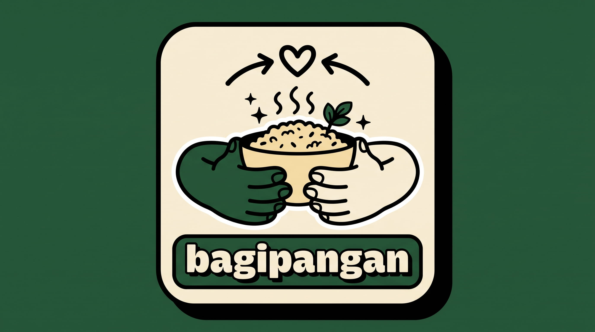
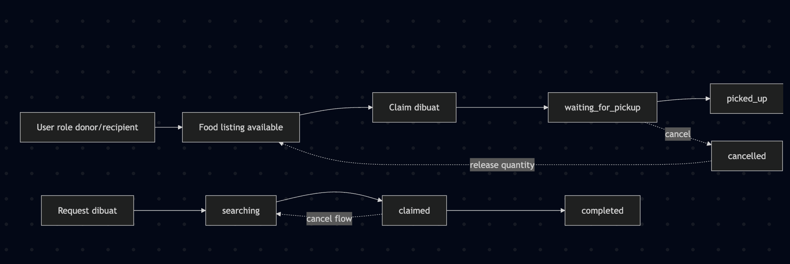

<p align="center">
  
</p>

<h1 align="center">BagiPangan</h1>
<p align="center">Share extra food with people nearby.</p>
<p align="center">
  <a href="https://bagipangan.my.id"><b>Live site: bagipangan.my.id</b></a>
  &nbsp;·&nbsp;
  <a href="https://app.bagipangan.my.id">API: app.bagipangan.my.id</a>
</p>

BagiPangan (formerly ZeroHunger) connects people who have **extra food** with people who **need it**. A donor posts a food listing, a recipient asks for food nearby, and the two are linked through a claim with a simple pickup code.

It started as a hacktiv8 final project and grew into a small, production-shaped stack: four Go microservices talking over gRPC, a React frontend, and a deployment that runs entirely behind Cloudflare — no inbound ports required.

---

## What it does

- **Accounts with roles.** Register as a donor or recipient, log in, get a JWT. Donor-only routes are enforced.
- **Food listings.** Donors post what they have (quantity, location, pickup window) and can update or cancel their own listings.
- **Nearby search.** Recipients create a request with a location + radius and find listings around them.
- **Requests with a lifecycle.** `searching → claimed → completed`, with a clean path back to `searching` if a claim is cancelled.
- **Claims with pickup codes.** Claiming a listing reserves quantity and generates a 6-digit code. The donor verifies it at pickup.
- **Email notifications.** Claim confirmed / cancelled emails via Resend.
- **A real frontend.** A Vite + React app for the whole flow (donor and recipient views).

---

## Tech stack

| Layer               | Tech                                                     |
| ------------------- | -------------------------------------------------------- |
| Services            | Go, Echo (HTTP), gRPC                                    |
| Contracts           | Protocol Buffers (`zero-hunger-contracts`)               |
| Database            | PostgreSQL (Neon) with `sslmode=verify-full`             |
| Auth                | JWT (access + refresh)                                   |
| Email               | Resend                                                   |
| Frontend            | React + TypeScript + Vite                                |
| Edge                | Caddy (internal router + CORS) + Cloudflare Tunnel (TLS) |
| Local orchestration | Docker Compose                                           |
| CI                  | GitHub Actions                                           |
| Hosting             | Cloudflare Tunnel (API) + Cloudflare Pages (frontend)    |

---

## Architecture



```
zerohunger2/
  zero-hunger-contracts/        protobuf + generated Go code
  zero-hunger-user-service/     HTTP 8081 / gRPC 50051
  zero-hunger-food-service/     HTTP 8082 / gRPC 50052
  zero-hunger-request-service/  HTTP 8083 / gRPC 50053
  zero-hunger-claim-service/    HTTP 8084
  zero-hunger-infra/            docker-compose, Caddyfile, env, docs, Postman
  frontend/                     React + TypeScript + Vite app
  .github/workflows/ci.yml      CI pipeline
```

| Service | Role                        | Talks to (gRPC)     |
| ------- | --------------------------- | ------------------- |
| user    | accounts, auth, JWT         | —                   |
| food    | listings, nearby search     | user, request       |
| request | food requests, lifecycle    | user                |
| claim   | claims, pickup codes, email | user, food, request |

The services share one protobuf contract and talk to each other over gRPC inside the Docker network. The browser and Postman only ever speak HTTP.

---

## How the flow works

1. A donor registers and creates a food listing → `available`.
2. A recipient creates a request → `searching`, then finds a nearby listing.
3. Creating a claim reserves the quantity, moves the claim to `waiting_for_pickup`, and the request to `claimed`.
4. The donor verifies the 6-digit code → claim `picked_up`, request `completed`.

Cancelling a claim releases the quantity and puts the request back to `searching`.

---

## Getting started (local)

### Prerequisites

- Go 1.22+
- Docker + Docker Compose
- `psql` (or use the Neon SQL editor)

### 1. Create the databases

You need four: `user_db`, `food_db`, `request_db`, `claim_db` (one Neon project can host all four, or use local Postgres).

### 2. Run the migrations

One file per database:

```bash
psql "$USER_DATABASE_URL"    -f zero-hunger-user-service/migrations/001_init.sql
psql "$REQUEST_DATABASE_URL" -f zero-hunger-request-service/migrations/001_init.sql
psql "$CLAIM_DATABASE_URL"   -f zero-hunger-claim-service/migrations/001_init.sql

# food uses discrete DB_* vars, so pass its connection string directly:
psql "postgresql://<user>:<password>@<host>:5432/food_db?sslmode=verify-full" \
  -f zero-hunger-food-service/migrations/001_init.sql
```

### 3. Configure environment

```bash
cp zero-hunger-infra/.env.example zero-hunger-infra/.env
```

Fill in the database URLs, `JWT_SECRET`, and `RESEND_API_KEY`. For deployment, also set `CLOUDFLARE_TUNNEL_TOKEN` and `CORS_ALLOWED_ORIGIN`.

> All runtime config lives in **one** file: `zero-hunger-infra/.env`. The services read the process environment only — they don't load `.env` themselves. Compose injects everything.

### 4. Run

```bash
cd zero-hunger-infra
docker compose up --build
```

Services come up on `localhost:8081` (user), `:8082` (food), `:8083` (request), `:8084` (claim).

Each service also exposes `GET /healthz` (liveness) and `GET /readyz` (readiness, checks the DB).

### 5. Try it

Import `zero-hunger-infra/docs/Zero Hunger Local.postman_environment.json` and run `Zero Hunger E2E.postman_collection.json` in order.

---

## Frontend

The `frontend/` folder is a Vite + React + TypeScript app.

```bash
cd frontend
npm install
npm run dev      # http://localhost:3000
npm run build    # production build in dist/
```

In development, `vite.config.ts` proxies `/api/*` to the deployed API, so there is no CORS to deal with. For production, `.env.production` sets `VITE_API_BASE_URL` and the app calls the API directly (CORS is handled by Caddy).

---

## API at a glance

Base URL: `/api/v1`. All responses use the same envelope:

```json
{ "responseCode": "00", "responseMessage": "success", "responseData": {} }
```

| Service | Endpoints                                                                                                                |
| ------- | ------------------------------------------------------------------------------------------------------------------------ |
| User    | `POST /auth/register`, `/auth/login`, `/auth/refresh`, `/auth/logout` · `GET/PATCH /users/me` · `GET /users/{id}`        |
| Food    | `POST /food-listings` · `GET /food-listings` · `GET /food-listings/nearby` · `GET/PATCH/DELETE /food-listings/{id}`      |
| Request | `POST /food-requests` · `GET /food-requests/{id}` · `GET /users/{id}/food-requests` · `PATCH /food-requests/{id}/cancel` |
| Claim   | `POST /claims` · `GET /claims` · `GET /claims/{id}` · `POST /claims/{id}/verify-pickup` · `POST /claims/{id}/cancel`     |

Most routes require `Authorization: Bearer <token>`.

---

## Deployment

BagiPangan is deployed at **[bagipangan.my.id](https://bagipangan.my.id)** (frontend) with the API at **[app.bagipangan.my.id](https://app.bagipangan.my.id)**.

The whole backend runs behind a **Cloudflare Tunnel** — nothing exposes a port to the internet.

```
Cloudflare (TLS)
      │  cloudflared (outbound tunnel)
      ▼
    Caddy :80        ← routing + CORS (internal only)
      ├── /api/v1/auth*, /api/v1/users*      → user-service:8081
      ├── /api/v1/food-listings*             → food-service:8082
      ├── /api/v1/food-requests*             → request-service:8083
      └── /api/v1/claims*                    → claim-service:8084
```

- **API host:** `app.bagipangan.my.id` → `cloudflared` → Caddy → services
- **Frontend:** `bagipangan.my.id` on Cloudflare Pages
- **Database:** Neon (serverless Postgres)
- **No inbound firewall rules** — the tunnel is outbound-only.

Caddy also adds the CORS policy in one place, so the services don't need any CORS code. Set `CORS_ALLOWED_ORIGIN` to your frontend origin.

### Deploying changes

```bash
cd ~/apps/bagipangan && git pull
cd zero-hunger-infra && docker compose up -d --build
```

Services have `restart: unless-stopped`, so a reboot brings the stack back on its own.

---

## CI/CD

Every push to `main` and every pull request runs the workflow in `.github/workflows/ci.yml`:

1. **vet + test** — a matrix over all five Go modules (`contracts`, `user`, `request`, `food`, `claim`) running `go vet ./...` and `go test ./...`.
2. **config + images** (after tests) — validates `docker-compose.yml`, validates the `Caddyfile`, and builds all four Docker images.

That way a broken build, a bad test, or a mis-typed compose/Caddy change is caught before it reaches `main`.

The frontend deploys separately via Cloudflare Pages (auto-build on push). The backend deploy is currently manual (`git pull` + `docker compose up -d --build`).

---

## Tests

### Donor pickup verification

In the frontend, open **Verify Pickup**, find your listing, and enter the
recipient's six-digit pickup code. Claim IDs are resolved by the backend.
Available and fully reserved listings are shown; expired listings are hidden.

- `GET /api/v1/food-listings/mine` returns the authenticated donor's listings,
  including listings with no unreserved stock. An empty result is `[]`.
- `POST /api/v1/claims/verify-pickup` accepts `food_listing_id` and `claim_code`.
  The backend checks donor ownership and uses the existing verification flow to
  reject expired, cancelled, and already collected claims.

Deploy the food and claim services before deploying this frontend change.
For a manual check, claim all stock as a recipient, then verify that the fully
reserved listing is still visible to its donor. Enter a wrong code first, then
the recipient's correct code; only the correct code should complete the pickup.

```bash
# per service
cd zero-hunger-user-service && go test ./...

# or run the whole matrix locally
for d in zero-hunger-*-service zero-hunger-contracts; do (cd "$d" && go test ./...); done
```

There are unit tests for the use cases and for the health/readiness handlers, plus the Postman E2E collection for the full flow.

---

## Notes

- **One env source:** `zero-hunger-infra/.env`. Keep secrets out of git (it's ignored).
- **Fail-fast config:** services validate required env vars at startup and exit with a clear message instead of running with defaults.
- **Healthchecks:** Compose waits for each service to be healthy before starting the ones that depend on it.
- **Graceful shutdown:** services drain in-flight requests on `SIGTERM`.

See [`zero-hunger-infra/docs/END_TO_END_FLOW.md`](zero-hunger-infra/docs/END_TO_END_FLOW.md) for the detailed lifecycle and ownership rules.
